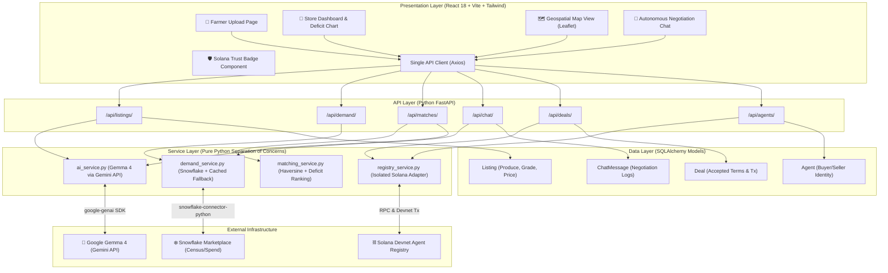
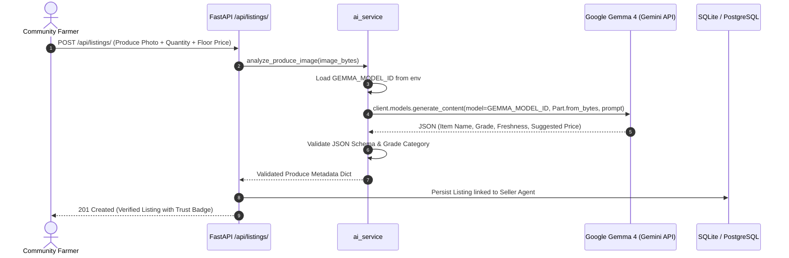

# 🍅 FoodMatch — Urban Food Desert Supply Chain Matchmaker

[](LICENSE)
[](https://fastapi.tiangolo.com)
[](https://react.dev)
[](https://ai.google.dev)
[](https://www.snowflake.com)
[](https://solana.com)

**FoodMatch** is an autonomous supply chain matchmaker designed for low-income urban food deserts. Corner stores and bodegas in these neighborhoods want to sell fresh produce, but commercial wholesalers bypass them because their order volumes are too small. Meanwhile, community gardens and rooftop farms throw away surplus harvests because they lack reliable retail sales channels.

FoodMatch bridges this gap with:
1. **Multimodal Produce Inspection & Listing Generation** powered by **Google Gemma 4** via the Gemini API SDK (`google-genai`).
2. **Predictive Deficit Scoring** per day of week powered by **Snowflake with CoCo** (Cortex Copilot) using census and consumer-spending datasets.
3. **Agentic Negotiation with Guardrails** ensuring farmer floor prices are never violated.
4. **Verifiable Onchain Identity & Trust** recorded on **Solana Devnet Agent Registry**.

---

## 🏛️ System Architecture



---

## 🤖 Google Gemma 4 Integration via Gemini API

Per the hackathon requirements, the exact model ID for Gemma 4 is **never hardcoded or guessed**. It is dynamically loaded from the `GEMMA_MODEL_ID` environment variable.

### Model Usage:
1. **Multimodal Produce Inspection (`ai_service.analyze_produce_image`)**:
   - Accepts image bytes (`image/jpeg`, `image/png`) uploaded by community farmers.
   - Outputs strict, validated JSON with:
     - Produce variety identification (`item_name`)
     - USDA-aligned quality grade (`grade`: "A", "B", or "C")
     - Freshness observations (`freshness_notes`: tautness, skin integrity, shelf life)
     - Consumer-facing marketplace summary (`description`)
     - Fair-market suggested price per kilogram (`suggested_price_per_kg`)
2. **Autonomous Negotiation with Floor Guardrails (`ai_service.negotiate`)**:
   - Acts as the community farm's autonomous seller agent.
   - Enforces a strict, programmatic floor price guardrail (e.g. `$2.10/kg`).
   - Rejects below-floor offers and counters with economically sustainable proposals.

### Request Flow:


---

## ❄️ Snowflake and CoCo (Cortex Copilot)

FoodMatch predicts the exact days of the week when each low-income urban neighborhood suffers from the highest fresh food deficit using Snowflake SQL.

- **Datasets Used**:
  - `US Census Bureau Demographics` (Snowflake Marketplace - Free): Granular poverty index and median household incomes across NYC tracts.
  - `Consumer Food Spending Patterns` (Snowflake Marketplace): Daily retail spend split into shelf-stable processed goods vs. fresh perishables.
- **SQL Analytics Pipeline**:
  - Located in [`sql/demand_deficit.sql`](sql/demand_deficit.sql) and setup in [`sql/snowflake_setup.sql`](sql/snowflake_setup.sql).
  - Calculates a normalized **Deficit Score (0.0 to 10.0)** per day of week.
  - In urban food deserts like the South Bronx (ZIP `10451`), Friday shows a peak deficit of **9.4/10** because corner stores run out of fresh items right before the weekend rush.
- **CoCo Prompts Used**:
  - *"Given the US demographics table and grocery spending index table in Snowflake Marketplace, write an optimized query to find zip codes where median income is under $35,000 and fresh produce expenditure is under 15% of total grocery spend."*
  - *"Construct a weighted deficit score from 0.0 to 10.0 that identifies which days of the week have the highest unmet demand for perishable produce at neighborhood bodegas."*
  - *"Add a fallback aggregation that orders the result consistently from Monday to Sunday for frontend visualization."*

---

## ⛓️ Solana Agent Registry (Devnet)

Every buyer (corner store) and seller (community garden) receives an immutable onchain identity on Solana Devnet.

- **Isolated Adapter Pattern**:
  - All blockchain logic is encapsulated in [`backend/app/services/registry_service.py`](backend/app/services/registry_service.py), preventing blockchain SDK lock-in and allowing swappable IDLs.
- **Onchain Operations**:
  - `register_agent`: Generates an onchain identity transaction on Solana Devnet.
  - `submit_feedback`: Upon closing a negotiation deal, a verified 5.0 ★ rating and deal receipt are logged onchain.
  - Real links to [Solana Explorer (Devnet)](https://explorer.solana.com/?cluster=devnet) are rendered across all UI components and Trust Badges.
- **Sample Seed Agent Addresses & Transactions**:
  - **South Bronx Green Workers Co-op**: Address `SolanaFarmBx1111111111111111111111111111111` | [Inspect Registration](https://explorer.solana.com/tx/5xSeedRegBxFarm9876543210devnetExplorerTxHash1?cluster=devnet)
  - **Melrose Fresh Grocery & Bodega**: Address `SolanaStoreMelrose3333333333333333333333333` | [Inspect Registration](https://explorer.solana.com/tx/5xSeedRegMelroseStore9876543210devnetTx4?cluster=devnet)
  - **Confirmed Deal Settlement**: [Inspect Onchain Receipt](https://explorer.solana.com/tx/5xSolanaDevnetConfirmedDeal998877665544332211AABBCCDDEEFF?cluster=devnet)

---

## 🤖 GitHub Copilot Usage

> **[Placeholder for User Input]**
> Document exact Copilot prompts used during the hackathon and which technical blocker they resolved:
>
> 1. **Prompt:** *"..."*
>    - **Blocker Solved:** ...
> 2. **Prompt:** *"..."*
>    - **Blocker Solved:** ...

---

## 🚀 Quickstart & Setup Guide

### Prerequisites
- Python 3.12+
- Node.js 20+
- Docker & Docker Compose (optional for containerized deployment)

### 1. Clone & Setup Environment
```bash
cp .env.example .env
# Edit .env and supply your GEMINI_API_KEY and GEMMA_MODEL_ID
```

### 2. Backend Setup (FastAPI)
```bash
cd backend
pip install -r requirements.txt
# Seed demo data (agents, listings, active negotiations)
python -m app.seed
# Start the FastAPI server
uvicorn app.main:app --reload --host 0.0.0.0 --port 8000
```
- Swagger Docs: `http://localhost:8000/docs`
- Health check: `http://localhost:8000/`

### 3. Frontend Setup (React + Vite)
```bash
cd frontend
npm install
npm run dev
```
- Open `http://localhost:5173` in your browser.

### 4. Running via Docker Compose
```bash
docker-compose up --build
```

---

## 🧪 Running Tests

```bash
cd backend
pytest -v tests/
```
Tests verify:
- Produce JSON parser and schema validator
- Gemma 4 negotiation guardrails (preventing sub-floor deals)
- Haversine distance calculations and multi-factor store ranking
- End-to-end FastAPI endpoint contracts with mocked services

---

## 📋 Manual Configuration Checklist (TODO)

Before deploying to production or judges' evaluation:

| # | Config Variable | File | Description |
|---|-----------------|------|-------------|
| 1 | `GEMINI_API_KEY` | `.env` | Get from [Google AI Studio](https://aistudio.google.com/) |
| 2 | `GEMMA_MODEL_ID` | `.env` | Exact Gemma 4 model string from AI Studio (never hardcode) |
| 3 | `SNOWFLAKE_ACCOUNT` | `.env` | Snowflake account locator for live queries (fallback active) |
| 4 | `SNOWFLAKE_USER` & `PASSWORD` | `.env` | Snowflake credentials with access to Marketplace database |
| 5 | `SOLANA_PRIVATE_KEY` | `.env` | Base58 devnet wallet private key for signing transactions |
| 6 | `SOLANA_REGISTRY_PROGRAM_ID` | `.env` | Deployed Solana Agent Registry Program ID |
| 7 | GitHub Copilot Section | `README.md` | Fill in your actual Copilot prompts in the placeholder above |

---

## 🎬 3-Minute Demo Walkthrough
See [`docs/demo-script.md`](docs/demo-script.md) for the exact step-by-step 3-minute hackathon demo script!
